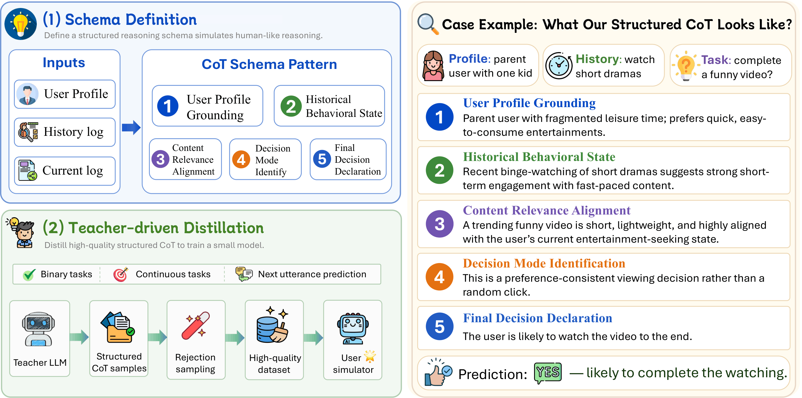

# OmniSimulator

Paper: https://arxiv.org/abs/2610.29472

<p align="center">
  
</p>


Large language models (LLMs) have shown great potential as general-purpose user simulators for interactive systems. Prior studies have demonstrated that training on high-quality data can substantially improve model reasoning and downstream task performance. However, the upper bound of user simulation is still constrained by the model's reasoning paradigm: native chain-of-thought often degenerates into shallow pattern matching and fails to adequately model the behavioral factors underlying real user decisions. In this paper, we propose OmniSimulator, a novel training framework designed to improve the predictive ability of small LLMs for realistic user simulation on short-video platform environments. Specifically, OmniSimulator organizes behavior-oriented reasoning through a structured schema with five dimensions, carefully selects data from real user-behavior scenarios, and introduces a teacher model to generate high-quality reasoning traces under the proposed schema, helping small models learn behavior-relevant reasoning patterns rather than relying on superficial behavioral correlations. Based on this process, we construct 9,881 high-quality training instances from three months of historical interaction trajectories of 200 real users, averaging about 50 distilled examples per user. Experimental results show that OmniSimulator improves the average score of Qwen3-8B by 34.33\%, achieves performance competitive with Claude-Sonnet-4.5, and supports smaller-scale, self-hosted deployment. 


## Data Availability

> **Training data.** The training data used in the original experiments comes from internal company data and is not included in this repository. To construct similar training samples, use the public behavior traces provided by [OmniBehavior](https://github.com/icip-cas/OmniBehavior), available through its [dataset release](https://huggingface.co/datasets/jiawei-ucas/OmniBehavior), and partition them into different temporal buckets.

This provides a public-data route to samples with a similar structure, the underlying data and resulting metrics may differ from the original experiments. 


## Repository Structure

```text
OmniSimulator/
├── src/
│   ├── dynamic_persona.py        # Behavior tasks and persona/state utilities
│   ├── generate_cusd_dataset.py  # Dataset generation entry point
│   └── prompt_utils.py           # Behavior formatting and template loading
├── prompts/                      # Prompt templates
├── scripts/
│   ├── run_example.sh            # Minimal command-line example
│   └── validate_input.py         # Optional read-only input checks
├── dataset/
│   └── example_input.json        # Synthetic example; no real user data
├── tests/                        # Offline regression tests
├── .env.example                  # Optional environment configuration
└── README.md
```

## Quick Start

The generator requires a running teacher model with an OpenAI-compatible chat-completions endpoint. Set `--api_base` to its URL and `--model` to the model name exposed by the server. The defaults are `http://127.0.0.1:30000/v1` and `gpt-oss-120b`.

The endpoint must support the `n` parameter for multiple sampled responses. Responses must include the `<think>...</think>` block requested by the supplied templates, followed by the prediction, in the returned message content.

```bash
python src/generate_cusd_dataset.py \
  --input_path dataset/example_input.json \
  --output_file outputs/cusd_sft_dataset.json \
  --model gpt-oss-120b \
  --api_base http://127.0.0.1:30000/v1 \
  --n_samples 3 \
  --max_workers 4 \
  --max_samples 50
```

For an authenticated endpoint, set `OPENAI_API_KEY` before running. Its default value, `sk-dummy`, is a placeholder for local servers that do not require authentication.

## Input Format

All input files use UTF-8 JSON. Two input modes are supported.

### Prepared experiment file

A prepared file contains a top-level `users` list. The minimal form supplies one target event per entry:

```json
{
  "users": [
    {
      "user_id": "user_001",
      "user_profile": "喜欢烹饪视频。",
      "action_history": [],
      "test_action": {
        "timestamp": "2025-11-02 09:30:00",
        "type": "视频浏览",
        "context": {"caption": "十分钟早餐教程", "duration": 30},
        "action": [
          {"type": "watch", "play_duration": 30, "is_complete_play": true},
          {"type": "like"}
        ]
      }
    }
  ]
}
```

### Raw data directory

Pass a directory containing JSON files that map user IDs to `user_profile` strings and `action_history` lists, following the [OmniBehavior data structure](https://github.com/icip-cas/OmniBehavior#data-structure):

```json
{
  "user_001": {
    "user_profile": "喜欢烹饪视频。",
    "action_history": []
  }
}
```

Populate `action_history` with event objects like the one above. Raw-directory mode requires at least 20 events per user. It sorts histories by timestamp, filters unusable targets, and samples up to `--test_length` target events per user. One event can produce multiple prediction tasks.

```bash
python src/generate_cusd_dataset.py \
  --input_path /path/to/omnibehavior/raw_user_data \
  --output_file outputs/cusd_sft_dataset.json \
  --target_users 200 \
  --test_length 50
```

## Citation
If you find our work useful in your research, please consider citing our paper.

```bibtex
@article{chen2026omnisimulator,
  title={OmniSimulator: Aligning Small Language Models for Authentic Heterogeneous Behavior Modeling},
  author={Chen, Jiawei and Xu, Ruoxi and Cao, Boxi and Li, Zhuoqun and Pan, Ruotong and Zhang, Yunfei and Yang, Zhirui and Chen, Jingyan and Gao, Tingting and Li, Han and others},
  journal={arXiv preprint arXiv:2610.29472},
  year={2026}
}
```
